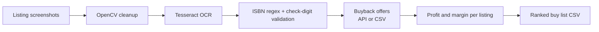

# Book Arbitrage Profitability Screener

A Python tool that reads used-book listings from marketplace screenshots, finds every valid ISBN with OCR, looks up buyback offers, and ranks which listings are worth buying.

I built it for my textbook reselling side business. Checking listings by hand meant typing ISBNs one at a time into a price checker. This screener does the whole batch at once and only flags listings that clear a 50% margin.

## How it works



1. **Image cleanup (OpenCV).** Each screenshot is converted to grayscale, upscaled 2x, denoised, and thresholded with Otsu's method. Dark-mode screenshots are inverted so text is always dark on light.
2. **OCR (Tesseract via pytesseract).** Reads the listing text, including the asking price.
3. **ISBN extraction and validation.** A regex finds ISBN-shaped numbers, common OCR misreads are corrected (O to 0, l to 1), and each candidate's check digit is verified. ISBN-10s are converted to ISBN-13. Invalid numbers are dropped, so a misread never reaches the pricing step.
4. **Buyback offers.** Offers come from the BookScouter API (live, needs a key) or from a CSV (offline, used by the demo). API responses are cached so each ISBN is requested once.
5. **Profit ranking (pandas).** For each listing, the best offer per book is summed and compared to the asking price:

   `net profit = sum of best offers - asking price`, `margin = net profit / asking price`

   Listings at or above the minimum margin (default 50%) are marked as buys and ranked first.

## Demo

The repo includes five synthetic screenshots, since real ones show sellers' names and photos. They cover a multi-book lot, a dark-mode screenshot, an ISBN-10, a listing with no ISBN, and a listing with a typo in the check digit.

```
python -m screener sample_screenshots --offers data/sample_offers.csv
```

```
                       listing  books_found  books_with_offers  asking_price  best_buyback_total  net_profit  margin   buy
    listing_01_nursing_lot.png            3                  3          30.0               45.85       15.85   0.528  True
      listing_03_dark_mode.png            1                  1           8.0               22.40       14.40   1.800  True
         listing_02_single.png            1                  1          15.0               18.00        3.00   0.200 False
listing_05_bad_check_digit.png            1                  1          12.0               13.50        1.50   0.125 False
        listing_04_no_isbn.png            0                  0           5.0                0.00         NaN     NaN False

2 of 5 listings clear the 50% margin.
```

Listing 5 contains two ISBNs, but one has an invalid check digit, so only the valid one is priced. Results are also saved to `output/ranked_listings.csv` and `output/book_offers.csv` (per-book vendor detail).

## Setup

Requires Python 3.10+ and the [Tesseract OCR engine](https://github.com/tesseract-ocr/tesseract).

```
git clone https://github.com/jagsingh-data/book-arbitrage-screener.git
cd book-arbitrage-screener
python -m venv .venv
.venv\Scripts\activate          # Windows
source .venv/bin/activate       # Mac
pip install -r requirements.txt
```

## Usage

```
# Offline, with a CSV of offers (columns: isbn13, vendor, price)
python -m screener path/to/screenshots --offers data/sample_offers.csv

# Live BookScouter offers (copy .env.example to .env and add your key)
python -m screener path/to/screenshots

# Options
--min-margin 0.4      # buy threshold, default 0.5
--fee-per-book 1.50   # subtract a per-book cost from each offer
--out results/        # where CSVs are saved, default output/
```

## Tests

```
pytest
```

Tests cover ISBN-10/13 validation, ISBN-10 to ISBN-13 conversion, OCR misread correction, rejection of phone numbers and bad check digits, price parsing, and the profit ranking logic.

## Project structure

```
screener/
  isbn.py        ISBN cleaning, validation, and extraction
  ocr.py         OpenCV preprocessing, Tesseract OCR, price parsing
  offers.py      BookScouter API client (cached) and CSV offer source
  profit.py      Per-listing profit, margin, and ranking
  __main__.py    Command line interface
scripts/
  make_sample_screenshots.py   Generates the demo screenshots
data/sample_offers.csv         Demo offer data
tests/                         pytest suite
```

## Tech

Python, OpenCV, Tesseract OCR (pytesseract), pandas, requests, pytest
